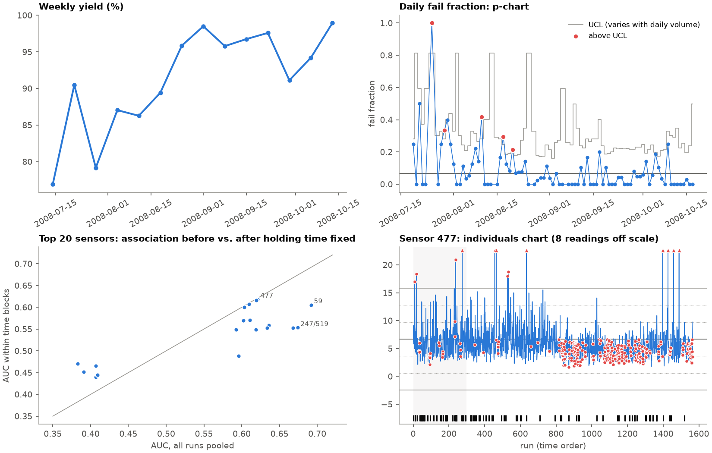

# SECOM Yield & SPC Analysis

SQL and Python analysis of the UCI **SECOM** semiconductor manufacturing dataset: 1,567 production runs,
590 anonymized sensor readings each, and a pass/fail result from in-house line testing (July–October 2008).

The question I set out to answer is the one a yield engineer gets on a Monday: *yield moved; which signals
should we look at first, and how sure are we?*



## What I found

1. **Yield improved strongly over the period**: weekly yield went from 76.9% (week of 14 July) to 98.9%
   (week of 13 October), with one dip to 91.1% in the week of 29 September. All five days above the
   p-chart upper limit fall before 21 August.
2. **That trend is the main trap in this dataset.** 20 sensors differ between passing and failing units
   (Mann-Whitney test, false discovery rate 5%). But any sensor that simply drifted over the three months
   will look "related to fails", because early runs failed more often. When I compare passing and failing
   units **only within the same time period** (8 equal time blocks, permutation test), 15 of those 20
   associations are no longer significant. Example: sensor 72 is missing more often in later runs, so
   "missing reading" looks protective (4.5% vs 8.8% fail rate) purely because of when it went missing.
3. **10 sensors are significant within time periods, forming 8 distinct signals** (sensors 477, 205 and
   341 correlate at |ρ| ≥ 0.96 and are treated as one). 5 of the 10 are survivors of the overall screen;
   the other 5 only stand out once time is held fixed. The effects are modest: within-period AUC 0.58–0.62
   (or 0.42 for the two sensors that run lower on failing units).
4. **Sensor 59 shows the largest process change in the data**: its level dropped and its spread narrowed
   between about 19 and 28 August, the same weeks yield jumped. Control limits set on the first 300
   readings flag 86% of the readings after them, which says the process moved, not that it is out of control now.
   I cannot tell from this data whether the change *caused* the improvement.
5. **Six runs are multi-sensor events**: 30–44 sensors are extreme at once (median run: 2; 99th
   percentile: 23). Only 1 of the 6 failed. A shared cause (tool event, recipe change, or a data-logging
   fault) is more likely than 40 independent problems.
6. **Single-sensor control-chart signals did not separate fails well.** After the baseline period,
   runs flagged by the Western Electric rules on the five charted sensors failed at 3.6%–11.4%,
   versus 4.5%–10.7% for unflagged runs. No sensor's signals marked clearly *more* fails (Fisher's
   exact test, smallest p = 0.054 for sensor 336, uncorrected for 5 tests); sensor 59's signals marked
   significantly *fewer* (3.8% vs 10.7%), because its shift coincides with the yield improvement. Univariate SPC tracks
   process stability; it is not a predictor of final test results.
7. **Predicting fails from sensors is weak, and random cross-validation overstates it.** Logistic
   regression with 40 selected features: balanced error rate 34% under 10-fold cross-validation (in line
   with the 33.5–40% baselines on the UCI page), but 48% when trained on the earliest 70% of runs and
   tested on the latest 30%, which is what using the model on future lots looks like.

| Features kept | 10-fold CV BER | Time-split BER | Time-split: fails caught / false alarms |
|---|---|---|---|
| 20 | 32.5% | 37.6% | 9 of 26 / 44 |
| 40 | 34.0% | 47.6% | 6 of 26 / 81 |
| 80 | 38.1% | 43.6% | 5 of 26 / 29 |

All three settings are shown; 40 was chosen in advance to match the UCI baselines, not tuned on the test set.

### If I were the yield engineer next week, I would check

1. **What changed in the week of 19–28 August** (sensor 59 step change, yield jump). If it was a
   deliberate fix, document it and re-baseline the control limits on the new process.
2. **The six multi-sensor event runs** (listed in `reports/summary.json`): tool and metrology logs for
   those timestamps, to tell a real process event from a data problem.
3. **The 29 September dip** (15 fails in 169 runs): break those runs down by the 8 time-robust signals
   and by tool and chamber, which this anonymized data does not include.

## Why there is no Cpk

The sensors are anonymized and the dataset has no specification limits. Cpk needs real spec limits;
inventing them would produce a number that looks precise and means nothing. This project uses control
limits (what the process does) instead of capability (what the customer requires).

## How it works

| Step | File | What it does |
|---|---|---|
| Load | `src/load.py` | raw files → SQLite: `runs(run_id, ts, fail)`, `measurements(run_id, sensor, value)` (long format, NULL = missing) |
| SQL | `sql/01`–`06` | missing-value audit, constant sensors, daily and 7-day volume-weighted yield, weekly yield, missing-vs-fail, pass/fail mean shift (window functions, CTEs, pivoting) |
| Screen | `src/screen.py` | Mann-Whitney + Benjamini-Hochberg; AUC within 8 time blocks with a 2,000-permutation test inside blocks |
| SPC | `src/spc.py` | I-MR limits (σ = MR̄/1.128), p-chart with limits that vary with daily volume, Western Electric rules 1–4 |
| Model | `src/model.py` | imputation + feature selection inside the pipeline (no leakage), 10-fold CV and time split |
| Report | `src/report.py` | runs everything, writes `reports/` (CSV tables, charts, `summary.json`) |

```bash
python3.12 -m venv .venv && .venv/bin/pip install -r requirements.txt
mkdir -p data/raw && curl -L -o data/raw/secom.zip https://archive.ics.uci.edu/static/public/179/secom.zip
unzip data/raw/secom.zip -d data/raw
.venv/bin/python -m src.load && .venv/bin/python -m src.screen && .venv/bin/python -m src.report
.venv/bin/python -m pytest -q tests
```

Tests (18) use small synthetic data with known answers, for example a sensor that only drifts with time
must show no effect within time blocks. I also planted five bugs (wrong week bucketing, unweighted
rolling yield, Western Electric rules ignoring the side of the center line, pooled instead of within-block
AUC, σ from the standard deviation instead of the moving range); the tests fail for each.

## Limitations

- Sensor names, units, tools and process steps are anonymized, so findings point to *which signal* to
  investigate, not to a physical cause.
- The time-adjusted test was run on the 40 strongest overall candidates; a sensor with no overall
  association but a within-period one would be missed.
- Phase I limits use the first 300 readings of each sensor, which include the low-yield start of the
  period; in a real fab I would pick a period the process owner confirms was stable.
- 104 fails in total and as few as 4 in some time blocks: within-period estimates are noisy.

## Source and license

Data: McCann, M. & Johnston, A. (2008). *SECOM* [Dataset]. UCI Machine Learning Repository.
https://doi.org/10.24432/C54305 — licensed CC BY 4.0. The raw files are not redistributed here; the
commands above download them. Code: MIT.
